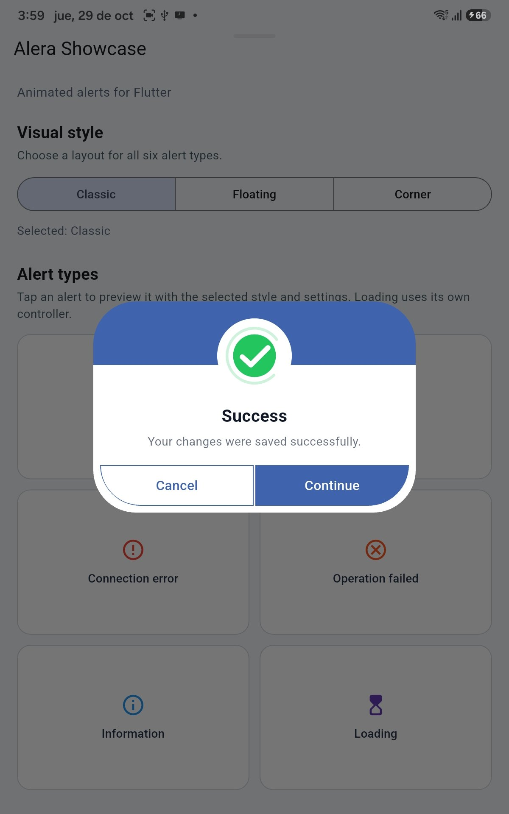
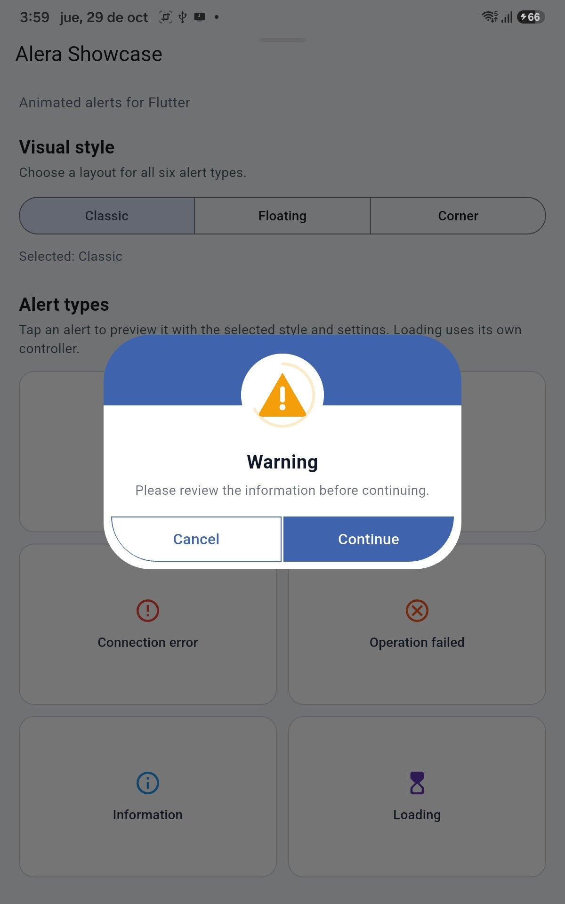
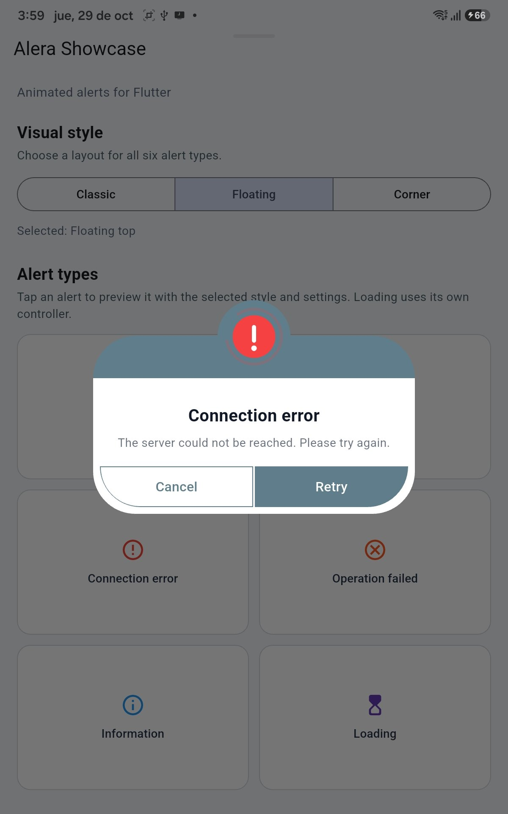
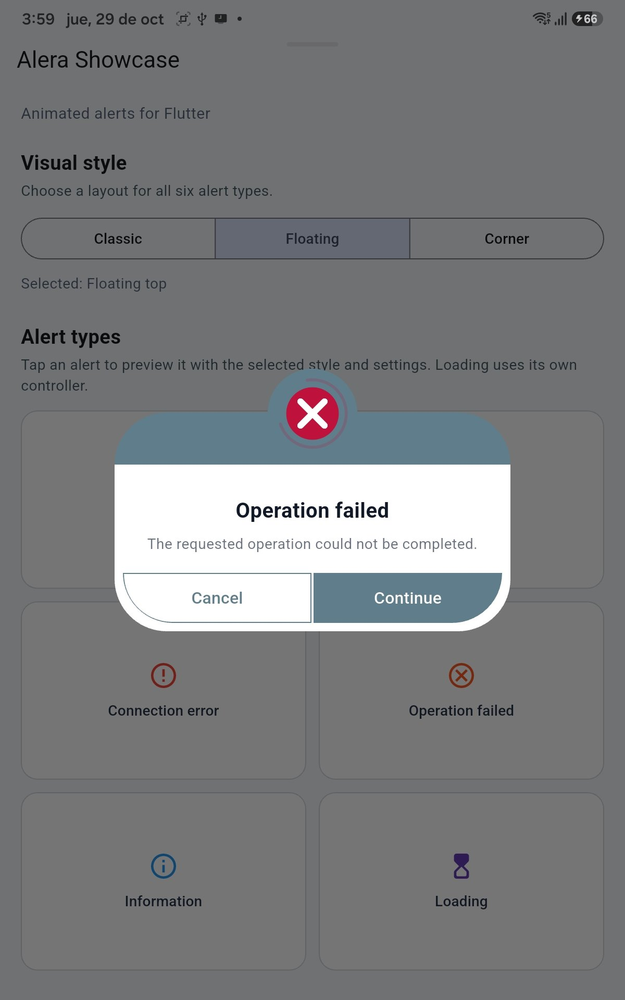
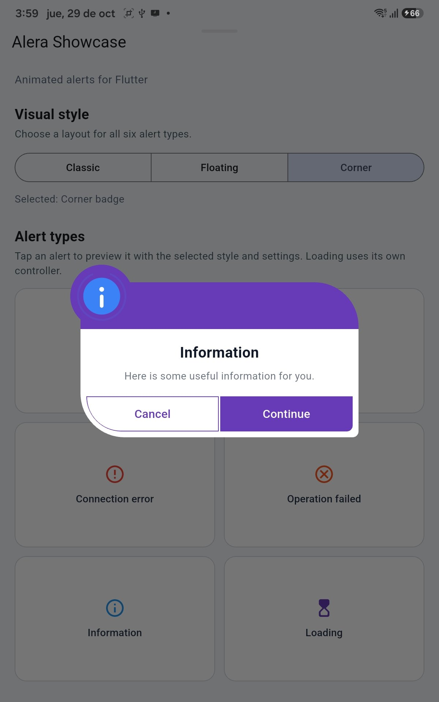
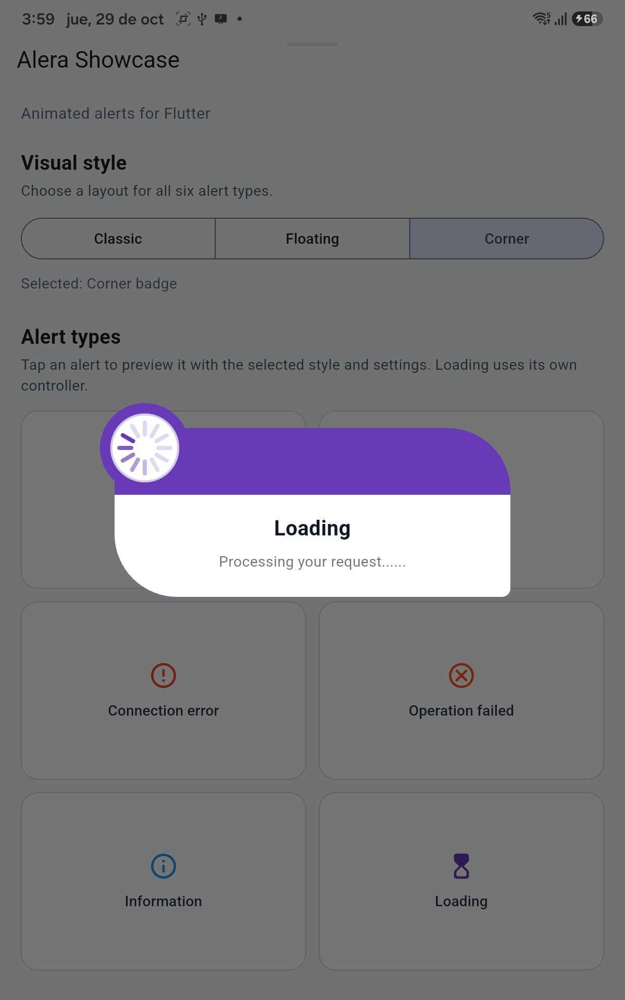

# Alera

**Customizable animated alerts for Flutter.**

Alera is a Flutter package for displaying expressive, customizable animated dialogs with semantic alert types, multiple visual styles, configurable transitions, actions, and loading controls.

Designed to integrate with your application's visual identity while keeping alert semantics independent from branding colors.

## Preview

Explore all six alert types and three visual styles included in Alera.

### Alert Types & Visual Styles

| Success · Classic | Warning · Classic | Error · FloatingTop |
|:---:|:---:|:---:|
|  |  |  |

| Fail · FloatingTop | Info · CornerBadge | Loading · CornerBadge |
|:---:|:---:|:---:|
|  |  |  |


### Animations in Action

See Alera's animated icons, transitions, and interactive dialogs.

**Alert animations and visual styles**

[Watch alert animations](https://github.com/MarCarrera/alera/blob/main/screenshots/animations/alera_alerts.mp4)

**Advanced interactions and loading**

[Watch advanced interactions](https://github.com/MarCarrera/alera/blob/main/screenshots/animations/alera_advanced.mp4)

> All demonstrations were recorded using the Alera Flutter example application.


## Features

- Six alert types: `success`, `warning`, `error`, `fail`, `info`, and `loading`.
- Three visual styles: `classic`, `floatingTop`, and `cornerBadge`.
- Configurable entrance and exit transitions.
- Animated semantic icons and a custom loading spinner.
- Animated loading messages.
- Support for zero, one, or two actions on standard alerts.
- Optional single action on loading alerts.
- Programmatic loading dismissal through `AleraController`.
- Customizable colors, border radius, padding, and button appearance.
- Responsive layouts and accessibility considerations.

## Installation

Add Alera to your Flutter project:

```bash
flutter pub add alera
```

Import the package:

```dart
import 'package:alera/alera.dart';
```

## Basic usage

Display a success alert:

```dart
Alera.show(
  context,
  type: AleraType.success,
  title: 'Success!',
  message: 'Your changes have been saved.',
);
```

Display an error alert:

```dart
Alera.show(
  context,
  type: AleraType.error,
  title: 'Something went wrong',
  message: 'Please try again.',
);
```

## Alert types

| Type | Purpose |
|---|---|
| `AleraType.success` | Successfully completed operations |
| `AleraType.warning` | Situations requiring attention |
| `AleraType.error` | Technical or unexpected errors |
| `AleraType.fail` | Operations completed with an unsuccessful outcome |
| `AleraType.info` | General information |
| `AleraType.loading` | Ongoing operations |

For programmatically controlled loading dialogs, use `Alera.showLoading()`.

## Visual styles

Choose between three different layouts:

```dart
Alera.show(
  context,
  type: AleraType.info,
  title: 'Information',
  message: 'This alert uses a floating icon layout.',
  style: AleraStyle.floatingTop,
);
```

Available styles:

- `AleraStyle.classic`
- `AleraStyle.floatingTop`
- `AleraStyle.cornerBadge`

## Transitions

Alera supports configurable transitions:

- `adaptive`
- `fadeScale`
- `top`
- `bottom`
- `left`
- `right`
- `tiltIn`
- `forward`
- `none`

Example:

```dart
Alera.show(
  context,
  type: AleraType.warning,
  title: 'Attention',
  message: 'Please review your information.',
  transition: AleraTransition.tiltIn,
);
```

The default `adaptive` transition automatically selects a transition based on the chosen visual style.

## Actions

Standard alerts support up to two actions.

```dart
Alera.show(
  context,
  type: AleraType.warning,
  title: 'Confirm action',
  message: 'Do you want to continue?',
  actions: [
    AleraAction(
      label: 'Cancel',
      onPressed: () {},
    ),
    AleraAction(
      label: 'Continue',
      isPrimary: true,
      onPressed: () {
        // Execute your action.
      },
    ),
  ],
);
```

Actions support synchronous and asynchronous callbacks.

Set `autoClose: false` on an action to prevent automatic dismissal after its callback completes.

## Loading alerts

Create a loading dialog and close it programmatically when an operation finishes:

```dart
final controller = Alera.showLoading(
  context,
  title: 'Processing',
  message: 'Please wait...',
);

try {
  await Future.delayed(const Duration(seconds: 2));
} finally {
  controller.close();
}
```

Loading dialogs are not dismissible by tapping outside by default.

A loading alert supports zero or one action.

You can also inspect `controller.isClosed` to check whether the controller has been closed.

## Customization

### Branding and semantic colors

```dart
Alera.show(
  context,
  type: AleraType.success,
  title: 'Completed',
  message: 'Your request was processed.',
  primaryColor: const Color(0xFF2563EB),
  stateColor: const Color(0xFF16A34A),
);
```

The primary color controls the main branding appearance, while the state color provides an optional semantic accent.

### Custom theme

```dart
Alera.show(
  context,
  type: AleraType.info,
  title: 'Custom theme',
  message: 'An alert using a custom appearance.',
  theme: const AleraTheme(
    primaryColor: Color(0xFF2563EB),
    backgroundColor: Colors.white,
    titleColor: Color(0xFF111827),
    messageColor: Color(0xFF6B7280),
    borderRadius: 24,
    contentPadding: 24,
    buttonHeight: 48,
  ),
);
```

## Dismissal behavior

Standard alerts allow outside-tap dismissal by default.

Disable this behavior by setting:

```dart
barrierDismissible: false,
```

Loading alerts disable outside-tap dismissal by default and can be closed through `AleraController`.

## Example application

Explore the complete Flutter example included in the repository:

[View the example application](https://github.com/MarCarrera/alera/tree/main/example)

## Issues and contributions

Bug reports, feature suggestions, and contributions are welcome.

[Report an issue](https://github.com/MarCarrera/alera/issues)

[Source code](https://github.com/MarCarrera/alera)

## License

Alera is distributed under the MIT License. See [LICENSE](https://github.com/MarCarrera/alera/blob/main/LICENSE) for details.

Copyright © 2026 MarCarrera.